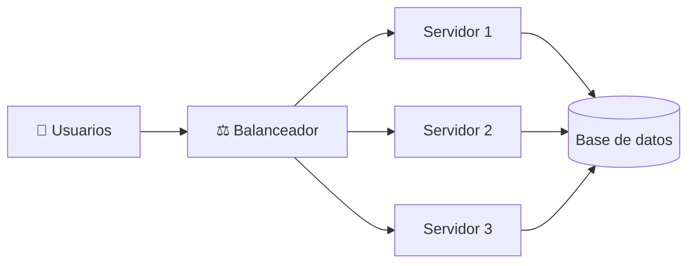
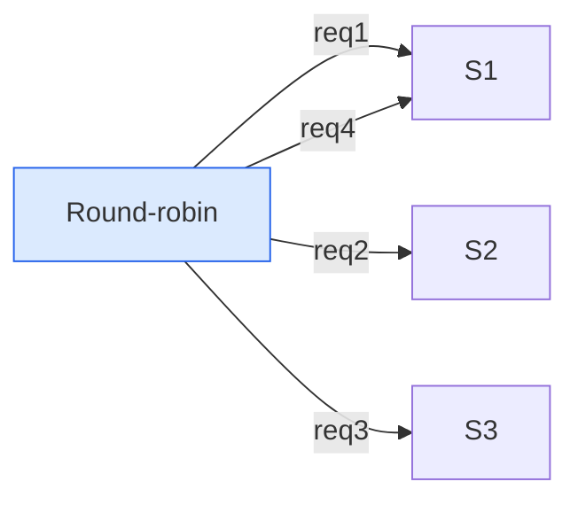
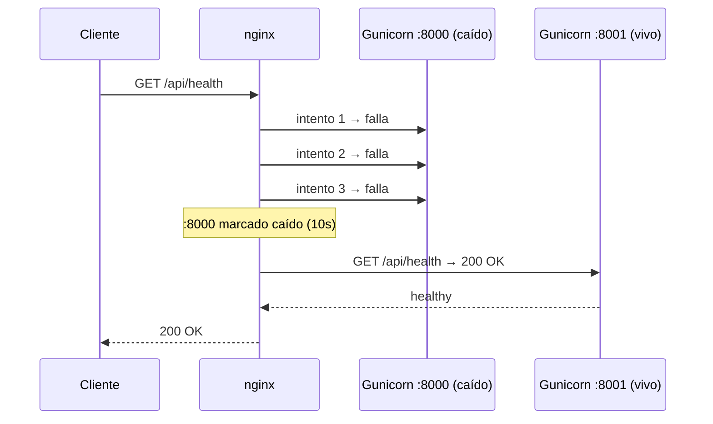
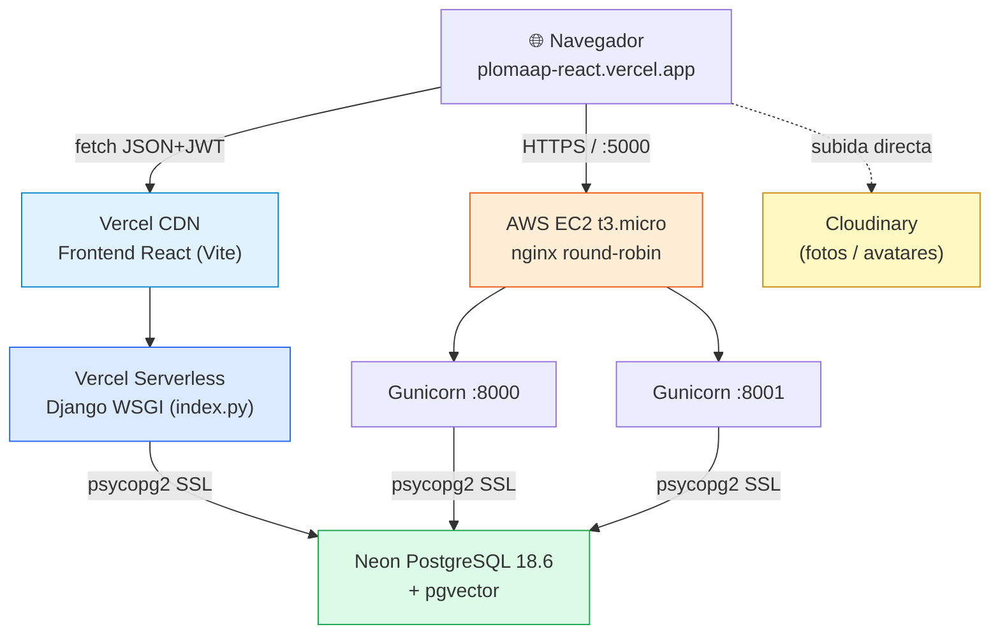

# 🚦 Balanceador de Carga — Guía Visual

> **¿Qué es un balanceador de carga, cómo funciona y cómo lo implementa PlomApp?**
> Una guía pensada para leerse bonita, con diagramas, analogías y código real.


---

## 📖 Índice

1. [¿Qué es un balanceador de carga?](#-qué-es-un-balanceador-de-carga)
2. [La analogía del restaurante](#-la-analogía-del-restaurante)
3. [¿Por qué lo necesitamos?](#-por-qué-lo-necesitamos)
4. [Tipos de balanceador](#-tipos-de-balanceador)
5. [Algoritmos de balanceo](#-algoritmos-de-balanceo)
6. [Health checks: detectar al caído](#-health-checks-detectar-al-caído)
7. [Proxy vs balanceador vs CDN](#-proxy-vs-balanceador-vs-cdn)
8. [Arquitectura de PlomApp](#-arquitectura-de-plomapp)
9. [Configuración real de nginx](#-configuración-real-de-nginx)
10. [Cómo verificar que balancea](#-cómo-verificar-que-balancea)
11. [Glosario](#-glosario)
12. [Referencias](#-referencias)

---

## 🎯 ¿Qué es un balanceador de carga?

Un **balanceador de carga** (load balancer) es un programa que recibe las peticiones de los usuarios y las **reparte entre varios servidores** que hacen el mismo trabajo.

> En una frase: **un repartidor inteligente de tráfico.**

Sin balanceador, todas las peticiones van a un único servidor. Si ese servidor se satura o se cae, la app deja de funcionar. Con balanceador, el tráfico se divide y, si un servidor muere, los demás siguen atendiendo.



---

## 🍽️ La analogía del restaurante

Imagina un restaurante con **una sola caja**:

- Si llegan 100 personas, la caja se satura, se forman filas enormes y los clientes se van.
- Si la cajera se enferma, el restaurante cierra.

Ahora imagina **3 cajas** y un **hostess** (balanceador):

- El hostess ve quién está libre y envía al cliente a esa caja.
- Si una caja se daña, el hostess simplemente no la usa.
- El cliente ni se entera de que hay 3 cajas: solo ve una entrada.

> El **balanceador es el hostess**. Los **servidores son las cajas**. El **cliente solo ve una puerta**.

---

## 🤔 ¿Por qué lo necesitamos?

| Problema sin balanceador | Solución con balanceador |
|---|---|
| Un servidor se cae → app caída | Tráfico se redirige a los demás |
| Mucho tráfico → servidor saturado | Se reparte la carga |
| Actualizar código → downtime | Se actualiza un servidor mientras los otros sirven |
| Un solo punto de falla | Alta disponibilidad (HA) |
| CPU/memoria limitada | Escalado horizontal (más máquinas, no más grande) |

> **Idea clave:** escalar *verticalmente* (más RAM/CPU a una máquina) tiene límite y es caro. Escalar *horizontalmente* (más máquinas pequeñas) es lo que hace el balanceador posible.

---

## 🧩 Tipos de balanceador

### Por capa del modelo OSI

| Capa | Nombre | Qué mira | Ejemplo |
|---|---|---|---|
| **Capa 4** (Transporte) | L4 / TCP | IP y puerto | AWS NLB, HAProxy (TCP) |
| **Capa 7** (Aplicación) | L7 / HTTP | URL, headers, cookies, host | nginx, AWS ALB, Traefik |

### Por dónde vive

| Tipo | Dónde corre | Ventaja | Desventaja |
|---|---|---|---|
| **Hardware** | Aparato físico (F5, Citrix) | Muy rápido | Muy caro |
| **Software** | En un servidor (nginx, HAProxy) | Gratis, flexible | Consume recursos del host |
| **Cloud gestionado** | AWS ALB, GCP LB, Azure LB | Sin mantenimiento | Costo por uso (~$16-20/mes) |
| **DNS** | Registros DNS (round-robin DNS) | Gratis | Sin health checks reales |

> En PlomApp usamos **nginx (software, L7)** porque es gratis y corre en la misma EC2. Un ALB de AWS costaría ~$16-20/mes y no entra en el free tier.

---

## ⚙️ Algoritmos de balanceo

| Algoritmo | Cómo decide | Cuándo usarlo |
|---|---|---|
| **Round-robin** | Turno por turno (1, 2, 3, 1, 2, 3…) | Servidores iguales, peticiones similares |
| **Weighted round-robin** | Más tráfico al servidor más potente | Servidores de distinto tamaño |
| **Least connections** | Al que tenga menos conexiones activas | Peticiones de duración variable |
| **IP hash** | Misma IP → mismo servidor | Necesitas "sticky sessions" |
| **Least response time** | Al más rápido | Servidores con latencias distintas |
| **Random** | Al azar | Simple, sorprendentemente efectivo |



> **PlomApp usa round-robin puro** porque los dos Gunicorn son idénticos (mismo código, mismo hardware) y las peticiones son similares.

---

## 🩺 Health checks: detectar al caído

Un buen balanceador no envía tráfico a un servidor muerto. Hay dos formas:

- **Activos:** el balanceador pregunta periódicamente "¿estás vivo?" (`GET /health` cada X segundos).
- **Pasivos:** si un servidor falla N veces seguidas, se marca como caído.

nginx usa **pasivos** por defecto con `max_fails` y `fail_timeout`:

```nginx
upstream plomaap_backend {
    server 127.0.0.1:8000 max_fails=3 fail_timeout=10s;
    server 127.0.0.1:8001 max_fails=3 fail_timeout=10s;
}
```

> Traducción: "si un backend falla 3 veces en 10 segundos, déjalo descansar 10 segundos antes de volver a probarlo."



---

## 🔀 Proxy vs balanceador vs CDN

| Concepto | Qué hace | Ejemplo |
|---|---|---|
| **Proxy inverso** | Recibe peticiones y las reenvía a un backend | nginx delante de un solo Gunicorn |
| **Balanceador** | Proxy inverso + reparte entre **varios** backends | nginx con `upstream` de 2 Gunicorn |
| **CDN** | Cachea contenido estático en servidores cercanos al usuario | Vercel, Cloudflare, CloudFront |
| **API Gateway** | Proxy + auth + rate limit + routing | Kong, AWS API Gateway |

> **nginx puede ser las tres cosas a la vez:** proxy inverso (termina TLS), balanceador (upstream) y servidor de estáticos (alias /static/).

---

## 🏗️ Arquitectura de PlomApp

PlomApp tiene **dos backends funcionales** apuntando a la **misma base de datos Neon**:



### ¿Por qué dos backends?

- **Vercel** cumple "todo en Vercel" y no cuesta nada (serverless).
- **AWS** cumple el requisito de **balanceador real + SSL** con un servidor de verdad.
- Ambos comparten Neon → los mismos datos en los dos.

### ¿Por qué nginx y no un ALB de AWS?

Un **Application Load Balancer** cuesta ~$16-20/mes y **no entra en el free tier**. nginx:

- Es **gratis**.
- Corre en la **misma instancia**.
- Hace round-robin, health checks pasivos, TLS y compresión.
- Para un proyecto escolar es la opción correcta.

> **Limitación honesta:** si la instancia entera se cae, el balanceador también. Alta disponibilidad real = 2 instancias en 2 zonas + ALB (ya no gratis).

---

## 📄 Configuración real de nginx

```nginx
upstream plomaap_backend {
    server 127.0.0.1:8000 max_fails=3 fail_timeout=10s;
    server 127.0.0.1:8001 max_fails=3 fail_timeout=10s;
}

# HTTP -> HTTPS
server {
    listen 80;
    server_name plomaap.duckdns.org 18-221-80-56.nip.io;
    location /.well-known/acme-challenge/ { root /var/www/html; }
    location / { return 301 https://$host$request_uri; }
}

# HTTPS con balanceo
server {
    listen 443 ssl;
    server_name plomaap.duckdns.org 18-221-80-56.nip.io;
    ssl_certificate     /etc/letsencrypt/live/18-221-80-56.nip.io/fullchain.pem;
    ssl_certificate_key /etc/letsencrypt/live/18-221-80-56.nip.io/privkey.pem;
    client_max_body_size 12M;

    location /static/ { alias /opt/plomaap/backend/staticfiles/; expires 7d; }
    location / {
        proxy_pass http://plomaap_backend;
        proxy_set_header Host $host;
        proxy_set_header X-Real-IP $remote_addr;
        proxy_set_header X-Forwarded-For $proxy_add_x_forwarded_for;
        proxy_set_header X-Forwarded-Proto $scheme;
        proxy_read_timeout 120s;
    }
}
```

### Los dos servicios Gunicorn

```ini
# /etc/systemd/system/plomaap.service  (puerto 8000)
[Service]
User=ubuntu
WorkingDirectory=/opt/plomaap/backend
EnvironmentFile=/opt/plomaap/backend/.env
ExecStart=/opt/plomaap/backend/venv/bin/gunicorn config.wsgi:application \
  --bind 127.0.0.1:8000 --workers 1 --threads 2 --timeout 90
Restart=always

# plomaap2.service es idéntico pero con --bind 127.0.0.1:8001
```

> **¿Por qué 1 worker y 2 threads?** La instancia tiene 1 GiB de RAM. Un worker de Django pesa ~120-180 MB. Dos procesos con 1 worker cada uno caben; 2 workers por proceso no.

---

## 🧪 Cómo verificar que balancea

```bash
# 1) Salud de ambos backends
for i in 1 2 3 4 5 6; do curl -s https://plomaap.duckdns.org/api/health; echo; done

# 2) Logs: verás que alterna entre plomaap (8000) y plomaap2 (8001)
sudo journalctl -u plomaap  -n 20 --no-pager | grep health
sudo journalctl -u plomaap2 -n 20 --no-pager | grep health

# 3) Simular caída de un backend
sudo systemctl stop plomaap
curl -s https://plomaap.duckdns.org/api/health   # sigue respondiendo via :8001
sudo systemctl start plomaap
```

---

## 📚 Glosario

| Término | Significado |
|---|---|
| **Upstream** | Grupo de servidores backend en nginx |
| **Round-robin** | Reparto por turnos |
| **Sticky session** | Misma IP → mismo servidor |
| **Failover** | Pasar el tráfico a otro servidor cuando uno cae |
| **HA (High Availability)** | Sistema que sigue funcionando aunque fallen partes |
| **TLS termination** | El proxy descifra HTTPS y habla HTTP con el backend |
| **X-Forwarded-Proto** | Cabecera que le dice al backend que el cliente usó HTTPS |
| **Cold start** | Primera petición lenta tras inactividad (serverless) |
| **Pooler** | Multiplexor de conexiones a la base de datos |

---

## 🔗 Referencias

- [Documentación de nginx (upstream)](https://nginx.org/en/docs/http/ngx_http_upstream_module.html)
- [Gunicorn docs](https://docs.gunicorn.org/)
- [AWS: Application Load Balancer pricing](https://aws.amazon.com/elasticloadbalancing/pricing/)
- [Neon (Postgres gratis)](https://neon.tech)
- [Vercel (hosting gratis)](https://vercel.com)
- [PlomApp backend repo](https://github.com/Ricy24/plomaap_django)

---

<p align="center">
  <sub>Hecho con ❤️ para estudiar despliegue real · PlomApp · 2026</sub>
</p>
